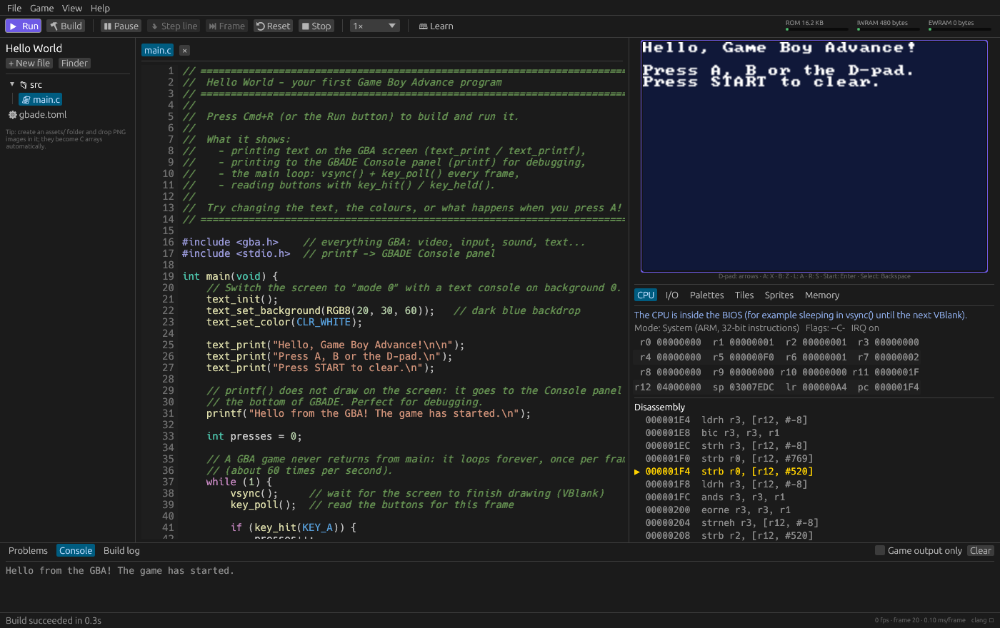

# GBADE

**Make your own Game Boy Advance games, with no setup.** GBADE is a
development environment where the code editor, the C compiler and a GBA
emulator live in one macOS app. Write C, press **⌘R**, and your game runs
next to your code, with breakpoints, a hardware inspector and error messages
written for beginners.



[](https://github.com/309nahe/gbade/actions/workflows/ci.yml)

## Why

Getting started with GBA homebrew usually means installing a cross-compiler,
a toolchain manager, makefiles, an emulator and a debugger, then wiring them
together. GBADE ships all of it inside one app:

- **No toolchain to install.** LLVM clang and lld are bundled and preconfigured
  for the GBA's ARM7TDMI processor. Projects have no makefile: every `.c` file in
  `src/` is compiled.
- **An emulator built in.** The accurate [mGBA](https://mgba.io) core runs your
  ROM next to the editor. `printf` goes to the IDE's Console.
- **A real debugger.** Click in the margin to set a breakpoint on a source line,
  step line by line, and inspect registers, palettes, tiles, sprites and memory
  while the game is paused.
- **Errors that teach.** Compiler and linker messages are shown on the right line
  with a plain-English hint ("IWRAM is full: move big arrays to EWRAM with
  `EWRAM_BSS`...").
- **Images just work.** Drop a PNG in `assets/` and it becomes C arrays: palette,
  tiles, sprite-sheet frames or a de-duplicated tile map.
- **Learn inside the app.** Eleven guides explain the GBA from your first pixel
  to sprites, sound, saving and debugging, plus five commented example games.

## Install

Download the DMG (from the CI artifacts or a release), open it and drag
**GBADE** onto **Applications**. Requires a Mac with Apple silicon and macOS 12
or newer.

GBADE is not signed with an Apple Developer ID yet, so macOS blocks a
downloaded copy ("GBADE is damaged" or "cannot be opened"). Run this once
after installing:

```sh
xattr -dr com.apple.quarantine /Applications/GBADE.app
```

## Your first game

1. Open GBADE and choose **Hello World** on the welcome screen. Click
   **Create from this**, then **Create**.
2. Press **⌘R**. The game appears on the right and prints to the Console.
3. Click the game screen and press **X** (the GBA's A button).
4. Change some text in `main.c` and press **⌘R** again.

Then open **📖 Learn** in the toolbar and start with *Getting Started*.

| GBA button | Key | GBA button | Key |
|---|---|---|---|
| D-pad | arrow keys | L / R | A / S |
| A / B | X / Z | Start / Select | Enter / Backspace |

## The examples

| Example | What it teaches |
|---|---|
| [Hello World](examples/hello-world) | the main loop, text on screen, `printf`, buttons |
| [Drawing](examples/drawing) | Mode 3 bitmap graphics, colours, a paint program |
| [Sprites](examples/sprites) | PNG sprite sheets, animation, gravity |
| [Scrolling World](examples/scrolling) | tiled backgrounds, VRAM layout, a camera |
| [Pong](examples/pong) | a complete game: states, collisions, sound, saving |

## A project

```text
my-game/
├── gbade.toml      name, ROM header, compiler options
├── src/main.c      your code (any .c / .s files under src/)
├── include/        your headers (optional)
├── assets/         PNG images, converted at every build (optional)
└── build/          the ROM (build/my-game.gba), the save file...
```

```c
#include <gba.h>
#include <stdio.h>

int main(void) {
    text_init();
    text_print("Hello, GBA!");
    while (1) {
        vsync();
        key_poll();
        if (key_hit(KEY_A)) printf("A pressed\n");
    }
}
```

The ROM in `build/` has a valid cartridge header: it runs in any GBA emulator
or on real hardware through a flash cart.

## Command line

The app is also a command-line tool:

```sh
alias gbade=/Applications/GBADE.app/Contents/MacOS/gbade
gbade new my-game --template sprites
gbade build my-game
gbade run my-game --frames 300 --press a@60 --screenshot shot.png
```

See [docs/cli.md](docs/cli.md).

## Documentation

- Guides, in reading order: [docs/guide/](docs/guide/), starting with
  [Getting Started](docs/guide/01-getting-started.md).
- [SDK API reference](docs/sdk-api.md), [Assets](docs/assets.md),
  [Command line](docs/cli.md), [Troubleshooting](docs/troubleshooting.md).

The same documents are readable inside the app (**📖 Learn**).

## Building GBADE from source

You need Rust (1.89 or newer), CMake and Xcode's command line tools.

```sh
git clone --recurse-submodules git@github.com:309nahe/gbade.git
cd gbade
cargo xtask fetch-llvm      # downloads LLVM 23.1.5 once (macOS arm64)
cargo run -p gbade          # build and open the IDE
cargo xtask dmg             # target/GBADE-<version>.dmg
```

### Repository layout

| Path | Contents |
|---|---|
| `crates/gbade` | the app: egui user interface, editor, debugger, CLI |
| `crates/gbade-toolchain` | the build system: clang/lld driver, asset converter, ROM builder, debug info |
| `crates/gbade-emu` | Rust bindings to mGBA (through a small C shim) |
| `sdk/` | the GBA C SDK: `gba.h`, startup code, linker script, small libc |
| `examples/` | the example projects, also used as templates |
| `docs/` | guides and reference, shown in the app's Learn panel |
| `xtask/` | developer tasks: fetch LLVM, icon, bundle, DMG, smoke test |
| `third_party/mgba` | mGBA 0.10.5 (git submodule) |
| `licenses/` | third-party license texts |

## Tests

```sh
cargo test --workspace
```

Around a hundred tests, at every level:

- **Unit tests** for the asset converter, diagnostics parser, ROM header, editor
  helpers, Markdown renderer and more.
- **End-to-end tests** that compile real C programs with the bundled compiler
  and run them in the emulator: 64-bit maths, software floats, `malloc`, save
  RAM persistence, breakpoints on source lines, sound timing, crash detection,
  and the error messages beginners see.
- **UI tests** that drive the real IDE headlessly: create a project, run it,
  introduce a compile error, hit a breakpoint by pressing a button, step, and
  save screenshots to `target/ui-snapshots/`.
- **Documentation checks**: guide naming, titles and working links.

`cargo xtask smoke` runs the packaged app's command line on every example.

### Continuous integration

[`.github/workflows/ci.yml`](.github/workflows/ci.yml) runs when something
lands on `main` (a merged pull request or a direct push), not on every
branch commit. It can also be started by hand from the Actions tab. On an
Apple silicon macOS runner it runs every test, builds the DMG,
smoke-tests it, and uploads the DMG and the screenshots as artifacts.

## Credits

GBADE builds on mGBA (MPL-2.0), LLVM clang/lld and compiler-rt (Apache-2.0
with LLVM exception), printf by Marco Paland (MIT), font8x8 by Daniel Hepper
(public domain), the agb project's gbafix (MPL-2.0) and egui. The Tonc tutorial
and GBATEK taught us the hardware. Full list and license texts:
[docs/CREDITS.md](docs/CREDITS.md) and [licenses/](licenses/).

Game Boy Advance is a trademark of Nintendo. GBADE is an independent tool,
not affiliated with Nintendo.

## License

GBADE's own code is licensed under either of [MIT](LICENSE-MIT) or
[Apache-2.0](LICENSE-APACHE), at your option. Third-party components keep
their own licenses (see above). Games you make with GBADE are yours.
