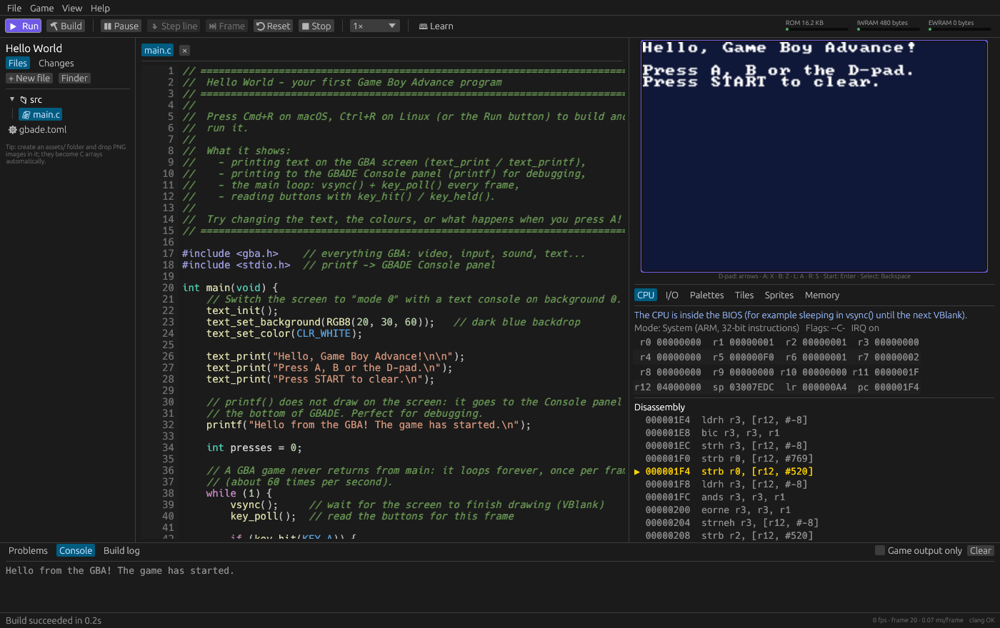
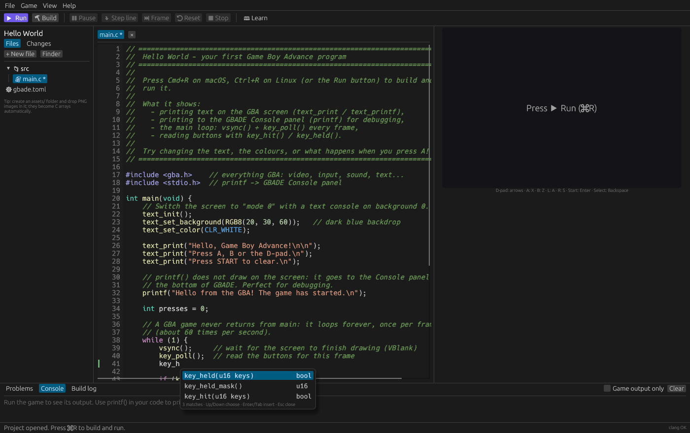
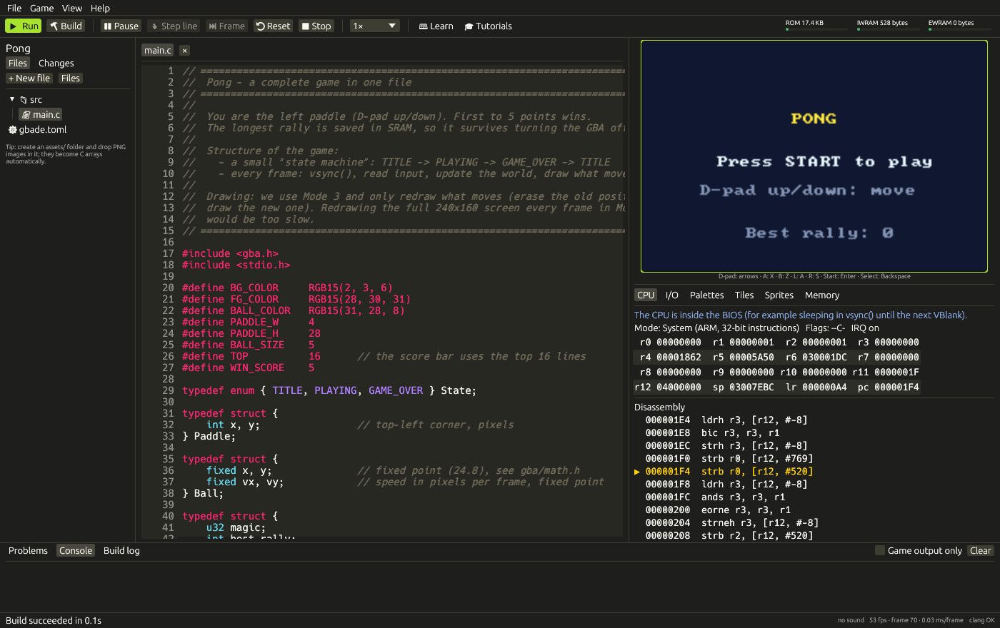
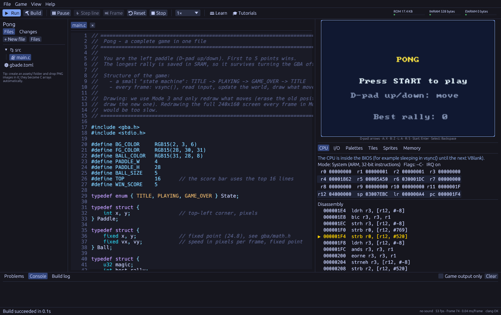
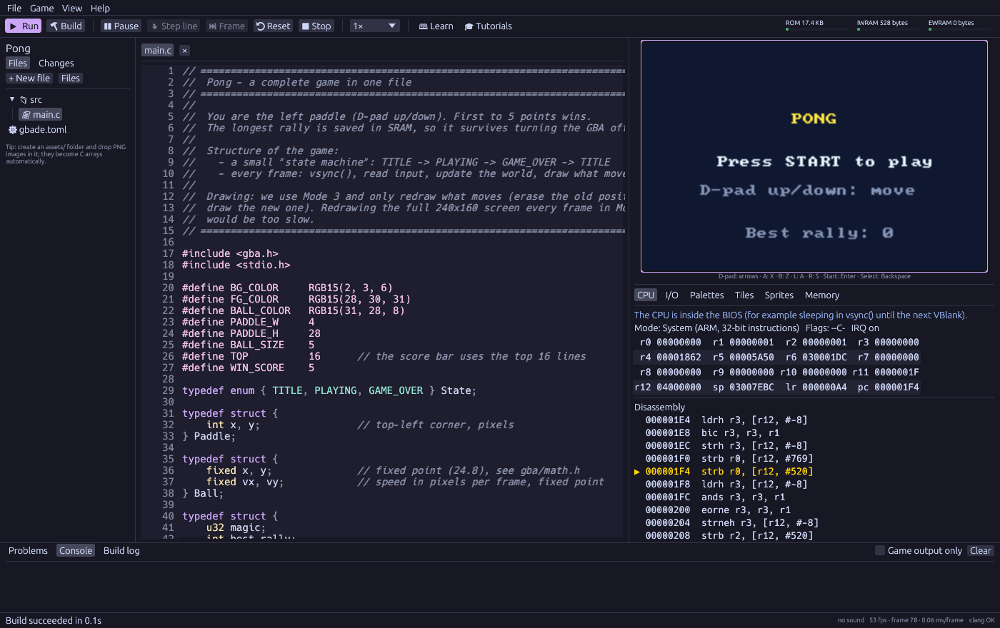

# GBADE

**Make your own Game Boy Advance games, with no setup.** GBADE is a
development environment where the code editor, the C compiler and a GBA
emulator live in one app, for macOS, Linux and Windows. Write C, press **⌘R**
(**Ctrl+R** on Linux and Windows), and your game runs next to your code, with
breakpoints, a hardware inspector, help while you type, built-in version
control, and error messages written for beginners.



[](https://github.com/309nahe/gbade/actions/workflows/ci.yml)

## Why

Getting started with GBA homebrew usually means installing a cross-compiler,
a toolchain manager, makefiles, an emulator and a debugger, then wiring them
together. GBADE ships all of it inside one app:

- **No toolchain to install.** LLVM clang, lld and clangd are bundled and
  preconfigured for the GBA's ARM7TDMI processor. Projects have no makefile: every `.c` file in
  `src/` is compiled.
- **An emulator built in.** The accurate [mGBA](https://mgba.io) core runs your
  ROM next to the editor. `printf` goes to the IDE's Console.
- **A real debugger.** Click in the margin to set a breakpoint on a source line,
  step line by line, and inspect registers, palettes, tiles, sprites and memory
  while the game is paused.
- **Help while you type.** The bundled clangd shows errors before you build,
  completes names (`key_h` → `key_hit`), explains any function on hover and
  jumps to its definition.
- **Version control built in.** Track changes with git without installing
  anything: see what changed, commit snapshots, browse history, undo a file.
- **Errors that teach.** Compiler and linker messages are shown on the right line
  with a plain-English hint ("IWRAM is full: move big arrays to EWRAM with
  `EWRAM_BSS`...").
- **Images just work.** Drop a PNG in `assets/` and it becomes C arrays: palette,
  tiles, sprite-sheet frames or a de-duplicated tile map.
- **Learn by doing.** Ten short tutorials take you from your first pixel to
  sprites, scrolling, game states and sound; each ends with an example you run
  in one click. Thirteen guides explain the GBA in more depth, and five
  commented example games show complete programs.

- **Pick your colours.** Besides GBADE's own light and dark themes, the
  editor and the whole window can wear Monokai, Tokyo Night or Catppuccin
  Mocha (**View → Theme**).



### Themes

| Monokai | Tokyo Night | Catppuccin Mocha |
|---|---|---|
|  |  |  |

## Install

Download the latest version from the
[releases page](https://github.com/309nahe/gbade/releases/latest):
`GBADE-<version>.dmg` for macOS, `gbade-<version>-linux-x86_64` for Linux,
`GBADE-<version>-windows-x86_64.zip` for Windows. Every push to `main` also
builds the three packages in CI (artifacts `GBADE-macos-dmg`,
`gbade-linux-x86_64` and `GBADE-windows-x86_64` of the latest
[CI run](https://github.com/309nahe/gbade/actions/workflows/ci.yml)).

### macOS (Apple silicon, macOS 12 or newer)

Open the DMG and drag **GBADE** onto **Applications**.

GBADE is not signed with an Apple Developer ID yet, so macOS blocks a
downloaded copy ("GBADE is damaged" or "cannot be opened"). Run this once
after installing:

```sh
xattr -dr com.apple.quarantine /Applications/GBADE.app
```

### Linux (x86-64, glibc 2.35+: Ubuntu 22.04, Debian 12, Fedora 36 or newer)

GBADE for Linux is **one executable file** with the compiler, emulator and
SDK inside. It runs on Wayland and X11. Nothing else to install:

```sh
chmod +x gbade-0.3.2-linux-x86_64
mv gbade-0.3.2-linux-x86_64 ~/.local/bin/gbade
gbade install-desktop     # optional: add it to the applications menu
gbade
```

The first start unpacks the bundled compiler into `~/.local/share/gbade/`
(a second or two, once).

### Windows (x86-64, Windows 10 or 11)

GBADE for Windows is a **portable ZIP**: no installer, no Visual C++ runtime,
nothing else to install.

1. Extract `GBADE-0.3.2-windows-x86_64.zip` anywhere (right-click,
   **Extract All…**). Keep the folder together: `gbade.exe` uses the
   `resources` folder next to it.
2. Double-click `gbade.exe`. GBADE is not code-signed yet, so the first time
   Windows may say "Windows protected your PC": click **More info**, then
   **Run anyway**.
3. Optional, in that folder: `.\gbade install-desktop` adds GBADE to the
   Start menu.

How each package works, and how the toolchain adapts to each platform:
[docs/platforms.md](docs/platforms.md).

## Your first game

1. Open GBADE and choose **Hello World** on the welcome screen. Click
   **Create from this**, then **Create**.
2. Press **⌘R** (**Ctrl+R** on Linux and Windows). The game appears on the right and
   prints to the Console.
3. Click the game screen and press **X** (the GBA's A button).
4. Change some text in `main.c` and run it again.

Then open **🎓 Tutorials** in the toolbar: ten short lessons, each with an
example you run in one click. The guides are in **📖 Learn**.

| GBA button | Key | GBA button | Key |
|---|---|---|---|
| D-pad | arrow keys | L / R | A / S |
| A / B | X / Z | Start / Select | Enter / Backspace |

## The tutorials

Short lessons for new GBA developers, built on the community's own material
(Tonc, Game Programming Patterns, Deku's sound tutorial) and linking to it
for more. Each one ends with **▶ Try this example**, which copies a small
project to your projects folder and runs it, and a few ideas to play with.

| Tutorial | You learn |
|---|---|
| [1. First Pixels](tutorials/01-first-pixels) | mode 3, the screen as an array, 15-bit colours |
| [2. The Game Loop](tutorials/02-the-game-loop) | frames, VBlank, steady speed |
| [3. Buttons](tutorials/03-buttons) | held, hit and released, directions as -1/0/+1 |
| [4. Smooth Movement](tutorials/04-smooth-movement) | fixed-point numbers, velocity, gravity |
| [5. Collisions](tutorials/05-collisions) | rectangle overlap, sliding along walls |
| [6. Tiles and Backgrounds](tutorials/06-tiles-and-backgrounds) | tiles, maps, charblocks and screenblocks |
| [7. Sprites and Animation](tutorials/07-sprites-and-animation) | OAM, the shadow OAM, animation frames |
| [8. Scrolling and a Camera](tutorials/08-scrolling-and-camera) | scroll registers, big maps, a camera |
| [9. Game States and Text](tutorials/09-game-states-and-text) | a state machine, the text console |
| [10. Sound Effects](tutorials/10-sound-effects) | the sound channels, beeps, a melody |

From a terminal: `gbade tutorials` lists them and
`gbade new my-game --template 03-buttons` creates a project from one.

## The examples

| Example | What it teaches |
|---|---|
| [Hello World](examples/hello-world) | the main loop, text on screen, `printf`, buttons |
| [Drawing](examples/drawing) | Mode 3 bitmap graphics, colours, a paint program |
| [Sprites](examples/sprites) | PNG sprite sheets, animation, gravity |
| [Scrolling World](examples/scrolling) | tiled backgrounds, VRAM layout, a camera |
| [Pong](examples/pong) | a complete game: states, collisions, sound, saving |

## A project

```text
my-game/
├── gbade.toml      name, ROM header, compiler options
├── src/main.c      your code (any .c / .s files under src/)
├── include/        your headers (optional)
├── assets/         PNG images, converted at every build (optional)
└── build/          the ROM (build/my-game.gba), the save file...
```

```c
#include <gba.h>
#include <stdio.h>

int main(void) {
    text_init();
    text_print("Hello, GBA!");
    while (1) {
        vsync();
        key_poll();
        if (key_hit(KEY_A)) printf("A pressed\n");
    }
}
```

The ROM in `build/` has a valid cartridge header: it runs in any GBA emulator
or on real hardware through a flash cart.

## Command line

The app is also a command-line tool. On Linux the downloaded file *is*
`gbade`; on Windows, type `gbade` in cmd or PowerShell in the GBADE folder (it
runs `gbade.com`, which waits for the command and returns its exit code); on
macOS, point an alias at the program inside the app:

```sh
alias gbade=/Applications/GBADE.app/Contents/MacOS/gbade   # macOS only
gbade new my-game --template sprites
gbade build my-game
gbade check my-game          # errors and warnings from clangd, without building
gbade run my-game --frames 300 --press a@60 --screenshot shot.png
```

See [docs/cli.md](docs/cli.md).

## Documentation

- Guides, in reading order: [docs/guide/](docs/guide/), starting with
  [Getting Started](docs/guide/01-getting-started.md). New in 0.2:
  [Code Assistance](docs/guide/12-code-assistance.md) and
  [Saving Your Work with Git](docs/guide/13-version-control.md).
- [Platforms and packaging](docs/platforms.md): the DMG, the single Linux
  file, the Windows ZIP, and how the bundled compiler is found on each.
- [SDK API reference](docs/sdk-api.md), [Assets](docs/assets.md),
  [Command line](docs/cli.md), [Troubleshooting](docs/troubleshooting.md).

The same documents are readable inside the app (**📖 Learn**).

## Building GBADE from source

You need Rust (1.89 or newer) and CMake, plus Xcode's command line tools on
macOS, the ALSA headers on Linux (`sudo apt install libasound2-dev
pkg-config cmake`), or on Windows the Visual Studio Build Tools with the
**Desktop development with C++** workload (`winget install Kitware.CMake`
for CMake).

```sh
git clone --recurse-submodules git@github.com:309nahe/gbade.git
cd gbade
cargo xtask fetch-llvm      # downloads LLVM 23.1.5 (clang, lld, clangd) for this machine, once
cargo run -p gbade          # build and open the IDE
cargo xtask dmg             # macOS: target/GBADE-<version>.dmg
cargo xtask linux           # Linux: target/gbade-<version>-linux-x86_64
cargo xtask windows         # Windows: target/GBADE-<version>-windows-x86_64.zip
```

### Repository layout

| Path | Contents |
|---|---|
| `crates/gbade` | the app: egui user interface, editor, code assistance UI, git panel, debugger, CLI |
| `crates/gbade-console` | `gbade.com`, the Windows command-line companion of `gbade.exe` |
| `crates/gbade-toolchain` | the build system: clang/lld driver, compile flags and `compile_commands.json`, asset converter, ROM builder, debug info, packaged resources, platform paths |
| `crates/gbade-emu` | Rust bindings to mGBA (through a small C shim) |
| `crates/gbade-lsp` | a small Language Server Protocol client driving the bundled clangd |
| `crates/gbade-git` | local git support on libgit2: status, diffs, commits, history |
| `sdk/` | the GBA C SDK: `gba.h`, startup code, linker script, small libc |
| `examples/` | the example projects, also used as templates |
| `tutorials/` | the tutorials: a lesson (`README.md`) and a project each |
| `docs/` | guides and reference, shown in the app's Learn panel |
| `xtask/` | developer tasks: fetch LLVM, icons, DMG, Linux file, Windows ZIP, smoke test |
| `third_party/mgba` | mGBA 0.10.5 (git submodule) |
| `licenses/` | third-party license texts |

## Tests

```sh
cargo test --workspace
```

About two hundred tests, at every level. All of them run on macOS, Linux
and Windows in CI.

- **Unit tests** for the asset converter, diagnostics parser, ROM header, debug
  info lookups, register decoders, editor helpers, completion filtering,
  Markdown renderer, the single-file packaging, platform paths and more.
- **Emulator tests** on a tiny hand-assembled ROM (no compiler needed): CPU
  stepping, breakpoints, memory, buttons as the game sees them, save states,
  video and audio output.
- **End-to-end tests** that compile real C programs with the bundled compiler
  and run them in the emulator: 64-bit maths, software floats, `malloc`, save
  RAM persistence, breakpoints on source lines (in ROM and IWRAM, across
  files), sound timing, crash detection, and the error messages beginners see.
- **Build rules**: what is recompiled when a header or a setting changes,
  defines and flags from `gbade.toml`, `-Werror`, assembly files, stale
  objects, broken images, the runtime cache shared by parallel builds.
- **The debugger and the IDE's logic**: real-time pacing, breakpoints set in
  the editor, step by line or frame, `assert` and `BREAKPOINT()`, crashes,
  files and tabs, unsaved changes, failed and successful builds.
- **Command-line tests** that run the `gbade` program itself: exit codes,
  output, button presses, screenshots, saves kept between runs.
- **Code assistance and git tests** against the real bundled clangd (live
  errors, completion, hover, go to definition into the SDK) and the real
  libgit2 (init, status, diffs, commits, history, discard).
- **UI tests** that drive the real IDE headlessly: create a project, run it,
  introduce a compile error, hit a breakpoint by pressing a button, step, see
  a live error and the completion popup, jump to a definition, commit, and
  save screenshots to `target/ui-snapshots/`.
- **Documentation checks**: guide naming, titles and working links.

`cargo xtask smoke` runs the packaged app's command line on every example
(`new`, `check`, `run`), after checking that the package uses its own
compiler, so the bundled compiler and clangd are tested inside the real
package.

### Continuous integration

[`.github/workflows/ci.yml`](.github/workflows/ci.yml) runs when something
lands on `main` (a merged pull request or a direct push), not on every
branch commit, and when a `v*` tag is pushed. It can also be started by hand
from the Actions tab, on any branch, for one platform or all three. Three
jobs run in parallel:

| Job | Runner | Builds | Artifact |
|---|---|---|---|
| macOS | `macos-latest` (Apple silicon) | `cargo xtask dmg` | `GBADE-macos-dmg` |
| Linux | `ubuntu-22.04` (x86-64, glibc 2.35) | `cargo xtask linux` | `gbade-linux-x86_64` |
| Windows | `windows-latest` (x86-64) | `cargo xtask windows` | `GBADE-windows-x86_64` |

Each job runs every test, builds its package, smoke-tests it on every
example, and uploads the package and the screenshots. On a `v*` tag
(`git tag v0.3.2 && git push origin v0.3.2`), a last job attaches the three
packages to a GitHub release for that tag.

## Credits

GBADE builds on mGBA (MPL-2.0), LLVM clang, lld, clangd and compiler-rt
(Apache-2.0 with LLVM exception), libgit2 (GPLv2 with linking exception),
Zstandard (BSD), printf by Marco Paland (MIT), font8x8 by Daniel Hepper
(public domain), the agb project's gbafix (MPL-2.0) and egui. The Tonc tutorial
and GBATEK taught us the hardware. Full list and license texts:
[docs/CREDITS.md](docs/CREDITS.md) and [licenses/](licenses/).

Game Boy Advance is a trademark of Nintendo. GBADE is an independent tool,
not affiliated with Nintendo.

## License

GBADE's own code is licensed under either of [MIT](LICENSE-MIT) or
[Apache-2.0](LICENSE-APACHE), at your option. Third-party components keep
their own licenses (see above). Games you make with GBADE are yours.
